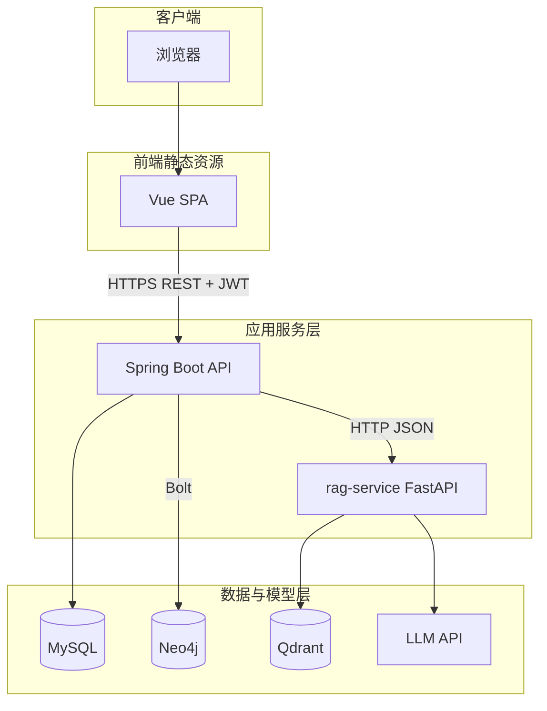
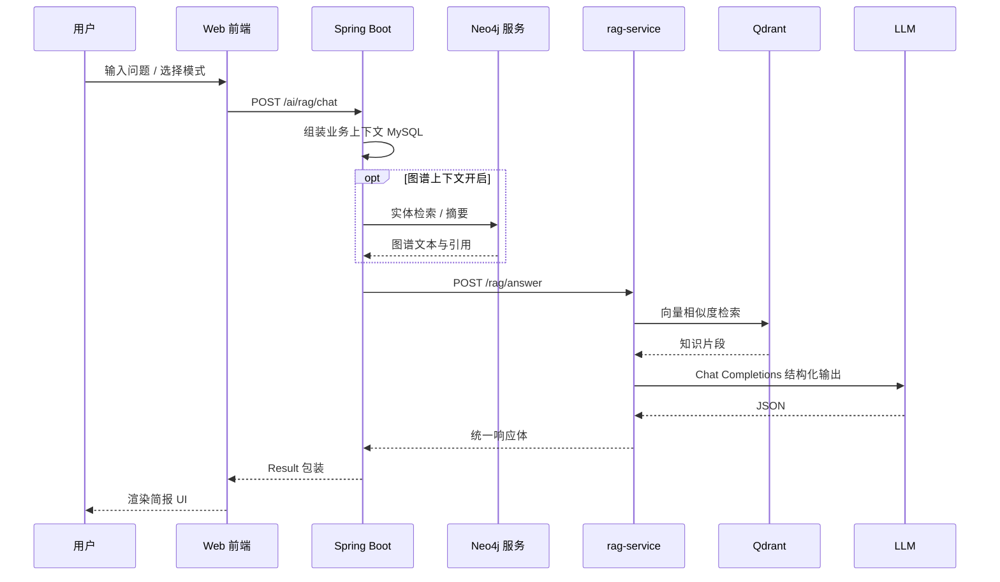
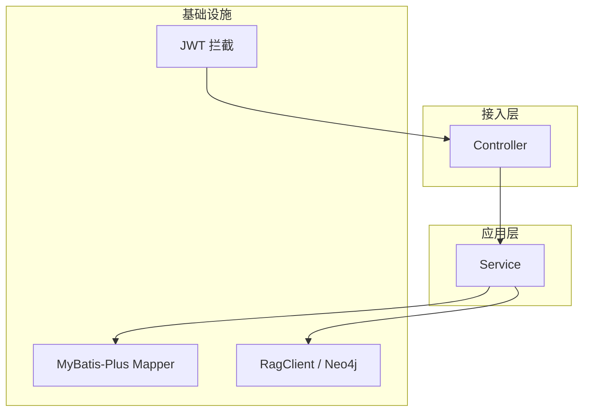
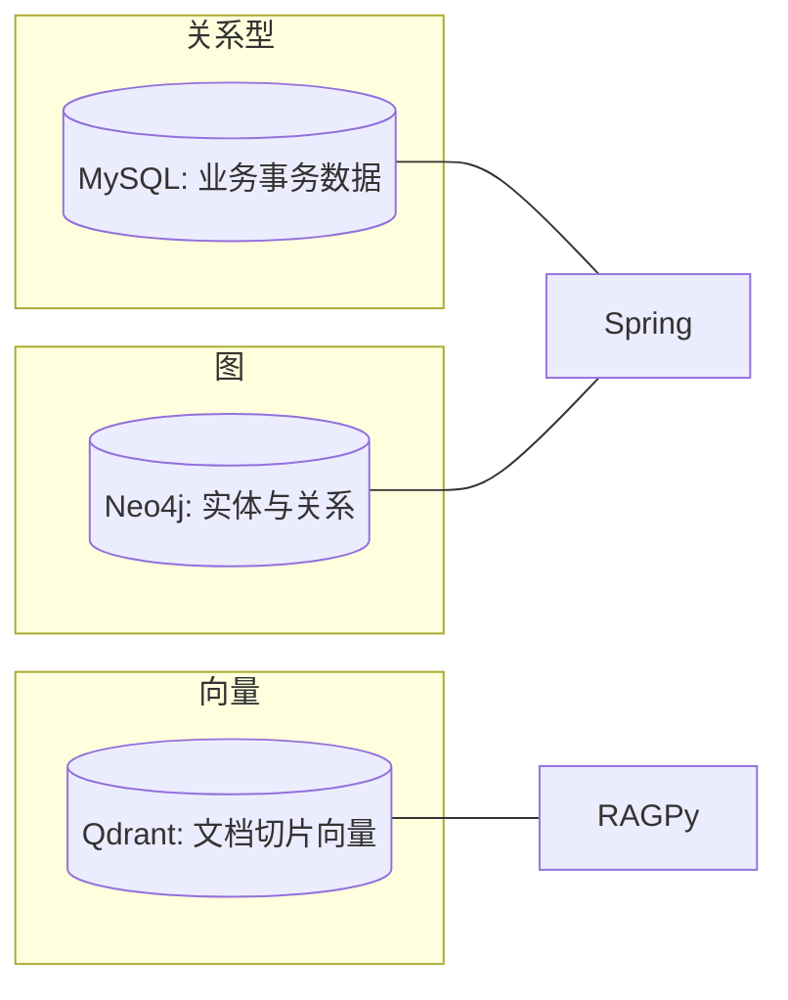

# 智慧农业管理系统（Smart Agriculture）

面向农业生产运营、环境监测与风险处置的一体化 Web 管理平台。系统采用前后端分离架构，在统一业务数据（MySQL）之上，集成**可配置规则与定时巡检**、**大语言模型辅助分析**、**检索增强生成（RAG）**与**农业知识图谱（Neo4j）**，支持从数据采集、异常识别、预警分派到处置归档的完整工作流。

---

## 1. 建设目标与适用范围

### 1.1 建设目标

| 目标 | 说明 |
|------|------|
| **生产要素数字化** | 对农田、作物、设备与环境监测数据进行集中维护与查询，为后续分析与决策提供统一数据源。 |
| **风险可感知、可追踪** | 基于阈值与设备状态生成预警，支持状态流转、处理日志与误报标记，形成可追溯闭环。 |
| **知识与数据协同** | 将结构化业务数据、向量知识库与图谱实体统一纳入问答与辅助分析，减少信息孤岛。 |
| **可运维、可扩展** | 服务边界清晰（业务网关 / RAG 微服务 / 向量与图数据库），便于独立扩容、替换模型或接入新数据源。 |

### 1.2 典型使用场景

- 农场或园区管理员维护基地档案、查看环境趋势与设备状态。  
- 运维或农艺人员处理预警单、记录处置过程并查阅历史分析。  
- 通过 AI 助手结合业务上下文与农业知识库，获取结构化结论与可执行建议。  
- 知识管理员维护图谱与文档索引，支撑检索与问答质量。

### 1.3 系统边界

- **本仓库包含**：管理端 Web 应用、Spring Boot API 网关与业务服务、独立 RAG 微服务、图谱与知识工程脚本。  
- **不包含**：田间物联网硬件接入 SDK、短信/邮件等通知通道的具体实现（可在现有接口上扩展）。  

---

## 2. 仓库目录与职责

| 路径 | 职责 |
|------|------|
| `smart-agriculture-web/` | 管理端前端：路由、页面、状态、与后端 API 交互。 |
| `smart-agriculture-server/` | 业务与集成层：认证授权、领域 CRUD、预警与巡检、AI 与 RAG 聚合、知识图谱 API。 |
| `rag-service/` | 检索与生成专用服务：向量检索、提示组装、调用大模型、抓取与入库脚本。 |
| `docker-compose.neo4j.yml` | 本地或测试环境一键启动 Neo4j（Browser + Bolt）。 |
| `docs/` | 使用说明与示例（如 AI 助手提问示例等）。 |
| `智慧农业管理系统-项目总说明.md` | 项目背景与功能补充说明（与本文档并行，可按需阅读）。 |

---

## 3. 技术栈

### 3.1 前端 `smart-agriculture-web`

- **运行时**：Vue 3（Composition API）、Vite  
- **路由与状态**：Vue Router、Pinia  
- **HTTP**：Axios（统一拦截器、JWT 携带、错误处理）  
- **UI**：Element Plus  
- **可视化**：ECharts（看板、环境监测等）  
- **样式**：全局 SCSS 变量与设计令牌（`src/assets/styles/`）

### 3.2 后端 `smart-agriculture-server`

- **运行时**：Java 17、Spring Boot 3  
- **构建**：Maven  
- **持久化**：MyBatis-Plus、MySQL  
- **安全**：JWT、拦截器、可配置匿名 URL  
- **接口文档**：SpringDoc OpenAPI（Swagger UI）  
- **集成**：HTTP 调用 `rag-service`；Neo4j 官方驱动访问知识图谱  

### 3.3 RAG 服务 `rag-service`

- **运行时**：Python 3、FastAPI、Uvicorn  
- **检索**：Qdrant 向量相似度检索  
- **模型**：OpenAI 兼容协议（Embeddings + Chat Completions；可与阿里云百炼等兼容端点对接）  
- **可选降级**：未配置密钥或依赖不可用时，可使用 mock 向量与 mock 结构化输出（便于开发与联调）  

### 3.4 外部系统与中间件

| 组件 | 作用 |
|------|------|
| **MySQL** | 业务主库：用户、农田、作物、设备、环境数据、预警与日志等。 |
| **Qdrant** | 存储文档切片向量，支撑语义检索。 |
| **Neo4j** | 存储实体与关系，支撑图谱浏览、子图查询及向 RAG 注入图谱摘要。 |
| **兼容 LLM API** | 提供对话与结构化 JSON 输出（具体厂商由环境变量配置）。 |

### 3.5 Docker 与容器化（仓库内现状）

本仓库**已纳入版本管理**的 Docker 编排目前**仅包含 Neo4j**，用于知识图谱本地/测试环境；**未提供**「Spring + 前端 + rag-service + MySQL」的一体化 `docker-compose.yml`，业务服务默认以本机进程运行（或通过你方 CI/CD 自行镜像化）。

| 资源 | 说明 |
|------|------|
| **`docker-compose.neo4j.yml`** | 启动 Neo4j 5.x 社区版。须先复制 **`.env.docker.neo4j.example` → `.env.docker.neo4j`**（后者勿提交），再执行 `docker compose -f docker-compose.neo4j.yml up -d`。 |
| **Qdrant（可选）** | 向量库常用官方镜像单独运行，例如：`docker run -d --name qdrant -p 6333:6333 qdrant/qdrant`。与 `rag-service` 中 `QDRANT_HOST`/`QDRANT_PORT` 对齐。 |
| **MySQL** | 可使用官方 `mysql:8` 镜像或云数据库；连接串与 `application.yml` 一致即可。 |
| **Spring / Vue / rag-service** | 仓库内**无**强制 Dockerfile；生产可将各子项目分别构建镜像，由 Compose 或 K8s 编排。 |

联调步骤与端口表见 `docs/端到端联调与测试手册.md`。

---

## 4. 功能模块说明

以下按**管理端菜单与后端领域**对齐说明：每个模块的**作用**、**主要能力**、**与其他模块的关系**。

### 4.1 认证与个人中心

- **作用**：标识操作者身份，保护业务与 AI 接口。  
- **能力**：管理员登录、JWT 签发与校验、个人资料与密码修改。  
- **关系**：前端请求除白名单外均携带 `Authorization`；登出或 401 时可清理本地会话（含 AI 助手持久化会话，按实现而定）。  

### 4.2 首页看板

- **作用**：集中展示关键运营指标与趋势，支持快速把握基地整体状态。  
- **能力**：汇总统计、图表序列、分布类数据（具体指标以后端 `Dashboard` 模块为准）。  
- **关系**：数据来源于环境监测、预警、设备等业务聚合接口，不直接写业务明细表。  

### 4.3 农田管理

- **作用**：维护基地空间与行政维度信息，作为设备、作物、环境数据关联的锚点。  
- **能力**：农田档案的增删改查、分页与筛选、详情展示。  
- **关系**：预警、设备、作物、环境数据常通过农田 ID 关联；AI 与 RAG 在「业务问答」模式下可携带农田相关上下文。  

### 4.4 作物管理

- **作用**：记录种植计划与作物档案，支撑农艺决策与环境阈值解释。  
- **能力**：作物信息维护、分页查询、条件筛选、详情。  
- **关系**：与农田关联；预警规则与知识检索可按作物类型扩展（视规则中心配置而定）。  

### 4.5 设备管理

- **作用**：管理物联网或现场设备资产及其运行/在线状态。  
- **能力**：设备档案、状态筛选、与农田等设备归属关系维护。  
- **关系**：设备离线类预警依赖设备状态；环境数据可与设备绑定。  

### 4.6 环境监测

- **作用**：汇聚温湿度、土壤湿度、光照等时序数据，支撑趋势分析与规则触发数据源。  
- **能力**：数据录入或接入、分页查询、图表展示。  
- **关系**：为预警引擎与 AI 分析提供原始曲线与快照说明。  

### 4.7 预警管理（含闭环）

- **作用**：将异常事件以工单形式分派、处理与归档，形成可审计闭环。  
- **能力**：  
  - 预警列表与多维筛选；  
  - 详情工作台：基本信息、环境/设备快照、状态操作；  
  - 状态流转（如：待确认 → 处理中 → 已处理 → 已闭环）；  
  - 处理日志时间线；  
  - 误报标记；  
  - 与 AI 分析、处置建议类接口联动（见 AI 模块）。  
- **关系**：依赖 `warning` 主表及处理日志、AI 分析等子表；可与最新预警联动 AI 助手默认上下文。  

### 4.8 规则中心

- **作用**：将阈值与规则从代码中抽离，便于按指标、等级等调整触发条件（具体以当前实现为准）。  
- **能力**：规则配置维护、列表与启用状态等。  
- **关系**：与定时巡检任务协同，向预警模块写入或更新预警记录。  

### 4.9 定时巡检与规则触发（后端）

- **作用**：按固定周期扫描环境与设备数据，根据规则生成或更新预警，减轻人工巡检压力。  
- **能力**：可配置调度间隔、批处理规模、回溯时间窗口等（见 `application.yml` 中 `smart-agri.inspection`）。  
- **关系**：写入预警模块；与规则中心配置共同决定触发行为。  

### 4.10 AI 助手（RAG 聚合入口）

- **作用**：在单一对话界面中，将用户问题与可选业务上下文、向量知识、图谱摘要一并交给 RAG 服务，返回**结构化简报**（摘要、结论、建议、引用等）。  
- **能力**：  
  - 多模式：自动、业务、知识、混合（由后端与 RAG 规划器解释）；  
  - 会话列表可持久化（如浏览器本地存储），减少重复输入；  
  - 前端展示分层折叠、证据计数、业务快照与知识引用等。  
- **关系**：  
  - 经 Spring `POST /ai/rag/chat` 聚合业务上下文、图谱片段，再调用 `rag-service`；  
  - 当 RAG 服务不可用且开启兜底时，由 Spring 返回本地结构化兜底结果。  

### 4.11 知识图谱（页面 + API）

- **作用**：以图结构表达农业概念、作物、病害、设备等实体及关系，支持可视化探索与按实体为中心浏览子图。  
- **能力**：图数据浏览、检索、入库或导入（含流水线接口，需密钥）、与 AI 助手跳转联动（URL 参数携带中心实体等）。  
- **关系**：Neo4j 存储；Spring 提供查询与导入；部分检索结果可注入 RAG 的 `knowledge_graph_context`。  

### 4.12 RAG 微服务（独立进程）

- **作用**：专注**高成本或易变**的检索与生成逻辑，与业务事务解耦，便于独立扩缩容与更换模型。  
- **能力**：  
  - `POST /rag/answer`：综合业务上下文、知识检索、图谱文本与查询规划，调用 LLM 输出结构化 JSON；  
  - `POST /rag/search`：轻量检索；  
  - `POST /rag/briefing`：简报类聚合；  
  - 知识库索引脚本、公开站点抓取与清洗（见 `rag-service/README.md`）。  
- **关系**：仅通过 HTTP 与 Spring 对接；依赖 Qdrant、可选 Neo4j 客户端配置、以及外部 LLM API。  

---

## 5. 架构设计

### 5.1 逻辑部署视图

### 5.2 AI 助手（RAG 问答）请求路径

### 5.3 后端内部分层（概念）

### 5.4 数据存储职责划分

### 5.5 独立 RAG 微服务：设计含义与协作方式

**是否采用「独立 RAG 微服务」结构？**  
是的：`rag-service`（FastAPI）与 `smart-agriculture-server`（Spring Boot）是**两个独立进程**，之间**仅通过 HTTP/JSON** 通信（Spring 中由 `RagClient` / `FastApiRagClient` 调用 `POST {baseUrl}/rag/answer` 等），**不共享内存、类加载器或数据库连接池**，也不在同一 JVM 内嵌 Python。

**这样划分的目的（如何理解）**

| 维度 | 说明 |
|------|------|
| **职责边界** | 业务事务、鉴权、从 MySQL 拉取预警/设备/农田等上下文、Neo4j 图谱摘要注入，由 **Spring** 统一完成；**向量化、Qdrant 检索、提示词拼装、调用大模型**等易变且偏算法侧的逻辑放在 **`rag-service`**，避免在 Java 单体中堆叠 Python/模型依赖。 |
| **技术栈** | Java 生态适合 CRUD、权限与集成；向量检索脚本、爬虫、知识工程多基于 Python，独立服务可减少技术栈混杂。 |
| **演进与发布** | 更换 Embedding 模型、调整切片或 Prompt 时，可**只发布 `rag-service` 镜像/进程**，无需每次全量发布后端 JAR。 |
| **扩缩容** | 问答峰值可与业务 API 分离扩容；可对 `rag-service` 单独限流或加实例。 |
| **故障隔离** | 当向量库或模型不可用时，Spring 侧可配置 **`smart-agri.rag.fallback-enabled`**，返回结构化兜底，主业务接口仍可部分可用。 |

**调用链（谁调谁）**

- **浏览器 → 仅 Spring**：前端 Axios 的 `baseURL` 指向 `http://host:8080/api`，**不直连** `rag-service`（避免浏览器跨域、重复鉴权与暴露内部端口）。  
- **Spring → rag-service**：服务端发起 HTTP，请求体包含 `query`、`mode`、`business_context`、`knowledge_graph_context` 等（与 FastAPI 契约一致）。  
- **rag-service → Qdrant / LLM API**：检索与生成在 RAG 进程内完成，**不**直接写 MySQL 业务表。

若将 RAG 逻辑全部并入 Spring，则需在 Java 中重复实现向量客户端、提示管线或与 Python 脚本混排，维护成本更高；当前结构属于典型的 **「业务网关 + 专用 AI/RAG 服务」** 拆分。

---

## 6. 目录结构（仓库级）

| 目录 | 说明 |
|------|------|
| `smart-agriculture-web/` | 前端工程源码与构建配置。 |
| `smart-agriculture-server/` | 后端工程源码、配置与 SQL 脚本。 |
| `rag-service/` | FastAPI 应用、`knowledge/` 样例文档、`scripts/` 入库与抓取脚本。 |
| `docs/` | 项目级文档。 |
| `docker-compose.neo4j.yml` | Neo4j 容器编排（详见 §3.5）。 |

---

## 7. 管理端页面与路由（前端）

| 路径 | 页面 | 模块说明（对应第 4 节） |
|------|------|-------------------------|
| `/login` | 登录 | 4.1 |
| `/dashboard` | 首页看板 | 4.2 |
| `/field` | 农田管理 | 4.3 |
| `/crop` | 作物管理 | 4.4 |
| `/device` | 设备管理 | 4.5 |
| `/environment` | 环境监测 | 4.6 |
| `/warning` | 预警管理 | 4.7 |
| `/warning-rule-center` | 规则中心 | 4.8 |
| `/ai` | AI 助手 | 4.10 |
| `/knowledge-graph` | 知识图谱 | 4.11 |
| `/profile` | 个人中心 | 4.1 |

---

## 8. 环境要求

| 组件 | 版本建议 |
|------|----------|
| JDK | 17+ |
| Node.js | 18+（LTS） |
| Python | 3.11+ |
| Maven | 3.8+ |
| MySQL | 8.x 或兼容版本 |
| 可选 | Docker（Neo4j 见 §3.5；Qdrant 可用官方镜像） |

---

## 9. 本地运行顺序（建议）

1. **MySQL**：创建数据库（与 `application.yml` 中库名一致），导入 `smart-agriculture-server/src/main/resources/db/` 下初始化脚本。若需自动补齐预警相关字段，保持 `smart-agri.warning.auto-migrate-closure-schema` 开启。  
   **敏感配置**：仓库内 `application.yml` 不包含真实数据库口令与 JWT 密钥；本地请设置环境变量 **`MYSQL_PASSWORD`**、**`JWT_SECRET_KEY`**，或复制 `application-local.example.yml` 为 **`application-local.yml`**（已 gitignore）并启用 profile `local`。  
2. **Spring Boot**：`cd smart-agriculture-server && mvn spring-boot:run`  
   - API：`http://localhost:8080/api`  
   - Swagger：`http://localhost:8080/api/swagger-ui.html`  
3. **前端**：`cd smart-agriculture-web && npm install && npm run dev`  
   - 开发地址：`http://localhost:5173`  
   - 后端地址由 `VITE_APP_BASE_API` 指定，默认 `http://localhost:8080/api`  
4. **rag-service**（AI 助手完整链路）：`cd rag-service`，创建虚拟环境、`pip install -r requirements.txt`，复制 `.env.example` 为 `.env` 并配置，执行 `uvicorn app.main:app --host 0.0.0.0 --port 9001 --reload`  
5. **Neo4j**（图谱功能）：复制仓库根目录 `.env.docker.neo4j.example` 为 **`.env.docker.neo4j`**（该文件已加入 `.gitignore`，勿提交），再执行 `docker compose -f docker-compose.neo4j.yml up -d`；Spring 中 **`SMART_AGRI_NEO4J_PASSWORD`** 须与 `NEO4J_AUTH` 中 `/` 右侧密码一致。  
6. **Qdrant**（语义检索）：启动 Qdrant 后，在 `rag-service` 下执行 `python scripts/index_knowledge.py` 完成入库（参数见 `rag-service/README.md`）。  

---

## 10. 配置要点

### 10.1 Spring Boot `application.yml`

| 配置前缀 | 含义 |
|----------|------|
| `spring.datasource.*` | MySQL 连接 |
| `smart-agri.jwt.*` | JWT 密钥、请求头、匿名白名单 |
| `smart-agri.ai.*` | 非 RAG 的 AI 调用（如预警分析等） |
| `smart-agri.rag.*` | RAG 开关、FastAPI 基地址、超时、兜底、默认 `top_k` |
| `smart-agri.knowledge-graph.*` | Neo4j、图谱功能开关、RAG 图谱上下文、流水线密钥等 |
| `smart-agri.inspection.*` | 定时巡检开关与批参数 |
| `smart-agri.warning.*` | 规则阈值、库表自动迁移等 |

支持通过环境变量覆盖，例如：`SMART_AGRI_RAG_BASE_URL`、`SMART_AGRI_RAG_FALLBACK_ENABLED` 等。

### 10.2 `rag-service` 环境变量

见 `rag-service/.env.example`：应用端口、CORS、Qdrant、OpenAI 兼容地址与密钥、Embedding/LLM 模型名、检索与模型失败时的 mock 策略、Neo4j 等。

### 10.3 前端

- `VITE_APP_BASE_API`：生产或联调环境下的后端 API 根路径。  

---

## 11. 主要 HTTP 入口

| 说明 | 地址示例 |
|------|----------|
| Spring 统一前缀 | `http://localhost:8080/api` |
| RAG 对话（经网关） | `POST /ai/rag/chat` |
| FastAPI 直连（联调） | `POST http://localhost:9001/rag/answer` |
| Swagger | `http://localhost:8080/api/swagger-ui.html` |
| FastAPI OpenAPI | `http://localhost:9001/docs` |

---

## 12. 构建与部署要点

- **前端**：`npm run build`，产物位于 `dist/`，由 Nginx 等托管；需将 `/api` 反向代理到 Spring Boot。  
- **后端**：`mvn -DskipTests package`，运行生成的 JAR；生产环境配置外置 `application.yml` 或环境变量。  
- **rag-service**：生产建议使用多进程 Uvicorn/Gunicorn，密钥与数据库连接通过环境变量注入，勿将含密钥的 `.env` 提交版本库。  
- **图谱与向量库**：Neo4j、Qdrant 应部署在内网或加认证；对外仅暴露 Spring 网关与前端。  

---

## 13. 运维与排障（简要）

| 现象 | 排查方向 |
|------|----------|
| AI 助手调用失败 | `rag-service` 是否监听、`smart-agri.rag.base-url` 是否正确、网络与防火墙。 |
| 无检索结果 | Qdrant 是否已建集合并执行 `index_knowledge.py`；集合名与向量维度是否与 Embedding 一致。 |
| 图谱无数据 | Neo4j 是否运行、后端连接配置是否正确、是否已执行导入或流水线入库。 |
| 401 | Token 是否过期、请求头是否携带 `Authorization`、路径是否在 JWT 白名单。 |

---

## 14. 安全与合规

- 禁止将生产数据库密码、JWT 密钥、大模型 API Key 提交至公共代码仓库。  
- 对管理接口、图谱流水线接口实施最小权限与密钥保护。  
- 抓取公开网页须遵守目标站点 `robots.txt` 与版权要求；本项目抓取脚本已按来源配置可控范围。  

---

## 15. 相关文档

- [docs/端到端联调与测试手册.md](docs/端到端联调与测试手册.md) — **本机全链路联调步骤、接口与浏览器验收清单**  
- [docs/Git与敏感信息.md](docs/Git与敏感信息.md) — **勿提交的密钥与本地配置方式**  
- [smart-agriculture-server/README.md](smart-agriculture-server/README.md)  
- [smart-agriculture-web/README.md](smart-agriculture-web/README.md)  
- [rag-service/README.md](rag-service/README.md)  
- [docs/AI助手-示例提问清单.md](docs/AI助手-示例提问清单.md)  
- [智慧农业管理系统-项目总说明.md](智慧农业管理系统-项目总说明.md)  

---

## 16. 维护说明

升级 Spring Boot、Vue 或 FastAPI 主版本前，请查阅各框架迁移指南并执行回归测试（登录、预警流转、RAG 问答、图谱浏览等关键路径）。生产环境建议补充监控告警、日志集中存储、数据库备份与灾备策略。

---

## 附录 A：后端 Java 模块包（概览）

| 包路径（`com.smartagri.modules.*`） | 职责 |
|-----------------------------------|------|
| `auth` | 登录、Token、当前用户 |
| `crop` | 作物领域 |
| `dashboard` | 看板聚合指标与图表 |
| `device` | 设备领域 |
| `environment` | 环境数据录入与查询 |
| `field` | 农田领域 |
| `inspection` | 定时巡检任务与日志 |
| `knowledgegraph` | Neo4j 图谱查询、导入、流水线 |
| `warning` | 预警主流程、流转、误报、与规则触发衔接 |
| `warning.rulecenter` | 规则配置中心 |
| `ai` | 通用 AI 分析（预警分析、对话等） |
| `ai.rag` | RAG 网关：请求 DTO、调用 FastAPI、图谱上下文注入、兜底响应 |

公共组件位于 `com.smartagri.common`、`com.smartagri.config`、`com.smartagri.security` 等包。

---

## 附录 B：`rag-service` HTTP 路由分组

| 路由前缀 / 分组 | 说明 |
|-----------------|------|
| `GET /health` | 健康检查 |
| `/rag/*` | 检索、问答、简报（见 `app/api/routes/rag.py`） |
| `/qdrant/*` | 集合与向量相关运维接口（见 `qdrant.py`） |
| `/knowledge-graph/*` 等 | 图谱辅助接口（见 `graph.py`） |
| `/knowledge/*` | 抓取任务与知识任务（见 `knowledge.py`） |

完整路径与请求体以运行实例的 OpenAPI 文档（`/docs`）为准。

---

## 附录 C：前端与后端的职责边界

| 层次 | 职责 | 不负责 |
|------|------|--------|
| **Vue SPA** | 展示、表单校验、会话状态、调用 REST | 不直连 MySQL/Qdrant/Neo4j |
| **Spring Boot** | 鉴权、事务、业务规则、编排 RAG 与图谱、兜底 | 不内嵌向量检索与 LLM 推理实现（委托给 `rag-service`） |
| **rag-service** | 向量检索、提示工程、调用 LLM、抓取与索引脚本 | 不管理农场主数据与预警状态机 |
| **MySQL / Qdrant / Neo4j** | 各自存储与检索能力 | 不跨库保证业务事务一致性（由 Spring 侧设计补偿与一致性策略） |
