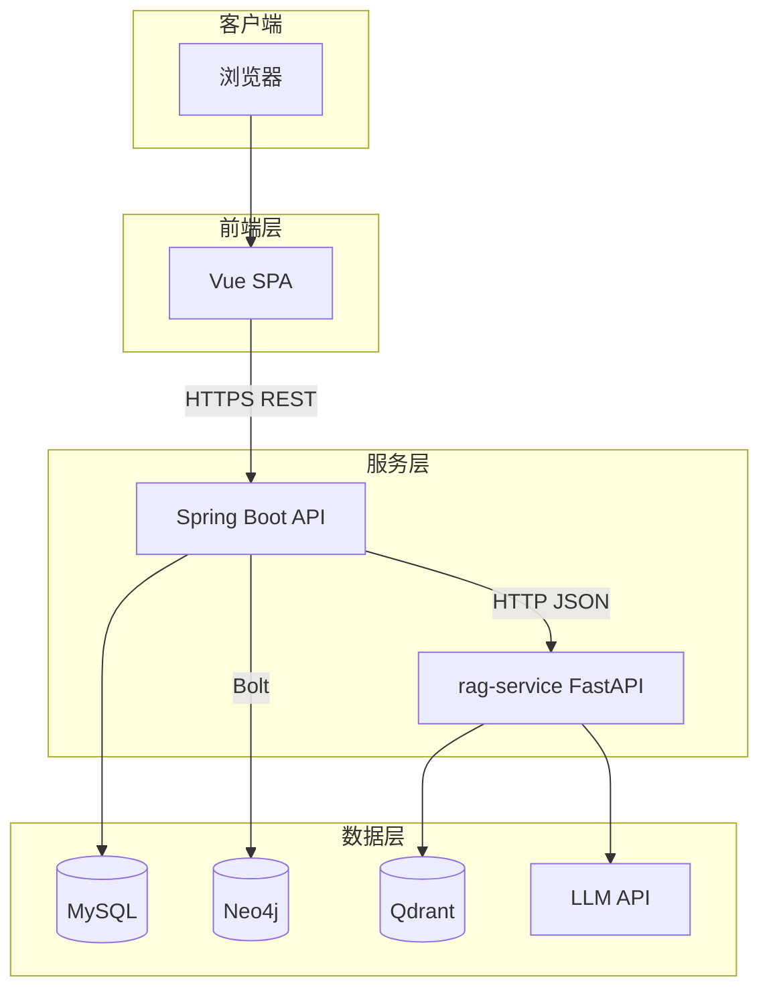
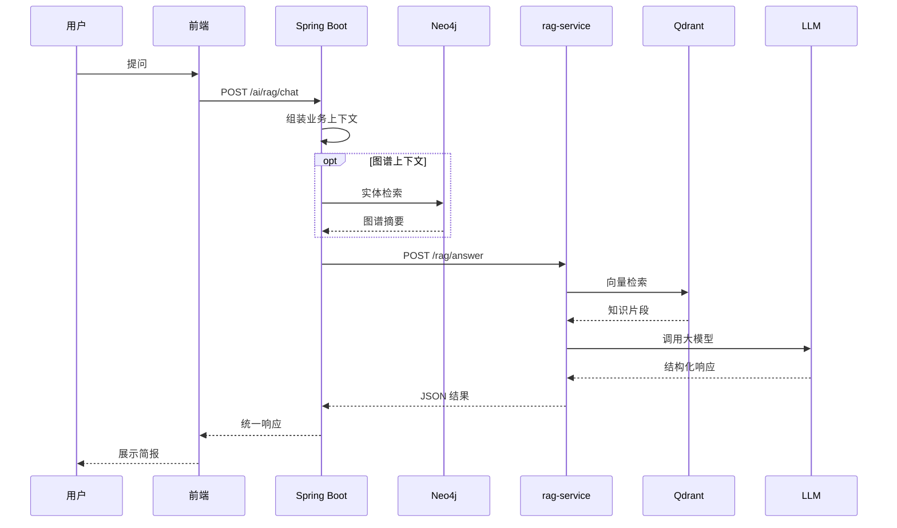

# 智慧农业管理系统 - 技术说明文档

## 1. 项目概述

智慧农业管理系统是一个面向农业生产运营、环境监测与风险处置的一体化 Web 管理平台。系统采用前后端分离架构，集成规则引擎、大语言模型辅助分析（RAG）、农业知识图谱等技术，覆盖从数据采集、异常识别、预警分派到处置归档的完整工作流。

### 1.1 核心能力

- **生产要素数字化**：农田、作物、设备与环境监测数据的集中维护
- **风险可感知、可追踪**：基于阈值生成预警，支持状态流转与闭环处理
- **AI 辅助分析**：通过 RAG 技术结合业务数据与农业知识库进行智能问答
- **知识图谱**：使用 Neo4j 存储农业实体关系，支持可视化探索

### 1.2 系统边界

**本系统包含**：
- 管理端 Web 应用（Vue 3）
- Spring Boot API 网关与业务服务
- 独立 RAG 微服务（FastAPI）
- 知识图谱与知识工程脚本
- Docker Compose 一键编排配置

**不包含**：
- 物联网硬件接入 SDK
- 短信/邮件等外部通知通道（可在现有接口上扩展）

---

## 2. 技术栈总览

| 层次 | 技术 | 说明 |
|------|------|------|
| **前端** | Vue 3 + Vite + Element Plus + ECharts | SPA 单页应用 |
| **后端** | Spring Boot 3 + MyBatis-Plus | 业务 API 与事务管理 |
| **AI 服务** | FastAPI + Uvicorn | 独立 RAG 微服务 |
| **向量库** | Qdrant | 文档向量语义检索 |
| **图数据库** | Neo4j | 农业知识图谱 |
| **关系库** | MySQL 8.x | 业务主数据 |
| **模型** | OpenAI 兼容协议 | Embeddings + Chat Completions |
| **部署** | Docker Compose | 多服务编排 |

---

## 3. 系统架构

### 3.1 部署架构



### 3.2 AI 问答流程



### 3.3 服务边界

| 服务 | 职责 | 通信方式 |
|------|------|----------|
| `smart-agriculture-web` | 路由、页面、状态管理、UI 展示 | Axios 调用后端 API |
| `smart-agriculture-server` | 认证、业务 CRUD、预警、图谱 API、RAG 聚合 | HTTP + MyBatis + Neo4j Driver |
| `rag-service` | 向量检索、Prompt 组装、LLM 调用、抓取脚本 | 独立的 FastAPI 进程 |

**设计理由**：RAG 相关的向量检索、模型调用等逻辑易变且依赖 Python 生态，独立服务可避免技术栈混杂，便于独立扩容与维护。

---

## 4. 目录结构

```
zhihuinongye/
├── docker-compose.yml              # 全栈编排（MySQL、Neo4j、Qdrant、RAG、后端、前端）
├── docker-compose.neo4j.yml       # 仅 Neo4j 编排
├── docker-compose-simple.yml      # 简化编排（不含前端）
├── docker/                        # Docker 配置
│   ├── nginx/
│   ├── mysql/
│   ├── web/
│   ├── reset-neo4j.sh/ps1
│   └── stack.env.example
├── docs/                          # 项目文档
│   ├── 端到端联调与测试手册.md
│   ├── AI助手-示例提问清单.md
│   └── Git与敏感信息.md
├── smart-agriculture-web/         # 前端（Vue）
│   ├── src/
│   ├── package.json
│   └── ...
├── smart-agriculture-server/      # 后端（Spring Boot）
│   ├── src/main/java/com/smartagri/
│   ├── src/main/resources/
│   │   ├── db/                    # 初始化 SQL
│   │   └── knowledge-graph/       # 图谱种子数据
│   └── scripts/                   # 图谱生成/导入脚本
├── rag-service/                   # RAG 微服务（Python）
│   ├── app/
│   │   ├── api/routes/
│   │   ├── core/
│   │   ├── models/
│   │   ├── schemas/
│   │   └── services/
│   ├── knowledge/                 # 示例知识文档
│   │   ├── crop/
│   │   └── tech/
│   ├── scripts/
│   │   └── index_knowledge.py    # 知识入库脚本
│   ├── .env.example
│   └── requirements.txt
├── data/                          # 共享数据目录（临时/中间数据）
├── .env                          # 环境变量（本地，勿提交）
├── .env.docker.neo4j.example
├── README.md
└── 其他配置文件
```

---

## 5. 核心模块详解

### 5.1 前端模块 (`smart-agriculture-web`)

**技术栈**：Vue 3 + Composition API + Vite + Element Plus + ECharts

**主要页面**：

| 路径 | 页面 | 功能 |
|------|------|------|
| `/login` | 登录 | 管理员认证 |
| `/dashboard` | 首页看板 | 关键指标与趋势图表 |
| `/field` | 农田管理 | 基地档案维护 |
| `/crop` | 作物管理 | 种植计划与档案 |
| `/device` | 设备管理 | 设备资产与状态 |
| `/environment` | 环境监测 | 温湿度、土壤等时序数据 |
| `/warning` | 预警管理 | 工单流转与处理 |
| `/warning-rule-center` | 规则中心 | 阈值配置 |
| `/ai` | AI 助手 | RAG 问答对话 |
| `/knowledge-graph` | 知识图谱 | 图谱可视化探索 |

**API 配置**：通过 `VITE_APP_BASE_API` 指定后端地址，默认 `http://localhost:8080/api`

### 5.2 后端模块 (`smart-agriculture-server`)

**分层结构**：

```
com.smartagri
├── common/            # 公共组件（异常处理、结果包装、工具类）
├── config/            # Spring 配置（MyBatis、OpenAPI、WebMvc）
├── security/          # JWT 拦截器与认证
├── modules/
│   ├── auth/         # 登录认证
│   ├── field/        # 农田管理
│   ├── crop/         # 作物管理
│   ├── device/       # 设备管理
│   ├── environment/  # 环境监测
│   ├── warning/      # 预警管理
│   │   └── rulecenter/  # 规则中心
│   ├── inspection/   # 定时巡检任务
│   ├── ai/           # AI 分析
│   │   └── rag/      # RAG 聚合网关
│   └── knowledgegraph/   # 知识图谱服务
```

**主要接口**：

| 模块 | 接口前缀 | 说明 |
|------|----------|------|
| 认证 | `/api/auth` | 登录、Token 校验 |
| 业务 CRUD | `/api/field`, `/api/crop` 等 | 各领域增删改查 |
| 预警 | `/api/warning` | 预警列表、详情、状态流转 |
| 规则中心 | `/api/warning-rule-center` | 规则配置 |
| 巡检 | `/api/inspection` | 巡检任务与日志 |
| AI 助手 | `/api/ai/rag/chat` | RAG 问答入口 |
| 知识图谱 | `/api/knowledge-graph` | 图谱查询与导入 |
| 健康检查 | `/api/health` | 服务状态 |

**Swagger**：`http://localhost:8080/api/swagger-ui.html`

### 5.3 RAG 微服务 (`rag-service`)

**职责**：向量检索、提示词组装、大模型调用

**主要接口**：

| 路径 | 方法 | 说明 |
|------|------|------|
| `/health` | GET | 健康检查 |
| `/rag/answer` | POST | 完整问答（含上下文、检索、生成） |
| `/rag/search` | POST | 仅向量检索 |
| `/rag/briefing` | POST | 简报生成 |
| `/qdrant/*` | - | Qdrant 运维接口 |
| `/knowledge-graph/*` | - | 图谱辅助接口 |

**数据流**：
1. 接收 Spring 转发的查询 + 业务上下文 + 图谱摘要
2. 向量化查询 → Qdrant 检索
3. 组装 Prompt → 调用 LLM
4. 解析结构化输出 → 返回给 Spring

**配置**：`rag-service/.env`（端口、CORS、Qdrant、Embedding 模型、LLM API 等）

### 5.4 知识图谱模块

**存储**：Neo4j（实体与关系）

**功能**：
- 图谱可视化浏览
- 实体检索与子图查询
- 批量导入（提���管理员接口与流水线脚本）

**种子数据**：
- `smart-agriculture-server/src/main/resources/knowledge-graph/` 下包含预置的农学常识三元组
- 可通过 `scripts/kg_ingest_pipeline.py` 自动入库

**Spring 集成**：
- `KnowledgeGraphNeo4jService` 提供查询与摘要生成
- RAG 流程中可注入图谱上下文

---

## 6. 数据模型

### 6.1 MySQL 核心表

| 模块 | 核心表 | 说明 |
|------|--------|------|
| 用户认证 | `user`, `role`, `permission` | 登录与权限 |
| 业务主数据 | `field`, `crop`, `device` | 农田、作物、设备 |
| 环境监测 | `environment_data` | 时序数据 |
| 预警 | `warning`, `warning_processing_log`, `warning_ai_analysis` | 预警工单与闭环 |
| 巡检 | `inspection_task`, `inspection_log` | 定时巡检 |
| 规则 | `warning_rule`, `warning_rule_condition` | 阈值规则 |

### 6.2 Qdrant 向量集合

- **集合名**：`agriculture_knowledge`（默认）
- **向量维度**：与 Embedding 模型一致（MiniLM-L12-v2: 384）
- **存储内容**：知识文档切片（标题、正文、元数据）

### 6.3 Neo4j 图谱实体

**实体类型**：作物、病害、虫害、肥料、设备、环境因子等  
**关系类型**：`CAUSES`（致病）、`TREATS`（防治）、`BELONGS_TO`（归属）、`REQUIRES`（需要）等

---

## 7. 环境要求

| 组件 | 版本���求 |
|------|----------|
| JDK | 17+ |
| Node.js | 18+（LTS） |
| Python | 3.11+ |
| Maven | 3.8+ |
| MySQL | 8.x |
| Docker | 最新稳定版（推荐） |

---

## 8. 配置说明

### 8.1 Spring Boot `application.yml`

关键配置前缀：

| 前缀 | 说明 |
|------|------|
| `spring.datasource.*` | MySQL 连接 |
| `smart-agri.jwt.*` | JWT 密钥、请求头、白名单 |
| `smart-agri.ai.*` | 通用 AI 调用 |
| `smart-agri.rag.*` | RAG 开关、FastAPI 地址、超时、兜底 |
| `smart-agri.knowledge-graph.*` | Neo4j 连接、图谱开关、流水线密钥 |
| `smart-agri.inspection.*` | 定时巡检参数 |
| `smart-agri.warning.*` | 预警规则与自动迁移 |

**环境变量覆盖**：`SMART_AGRI_RAG_BASE_URL`、`SMART_AGRI_RAG_FALLBACK_ENABLED` 等

### 8.2 RAG 服务 `.env`

参考 `rag-service/.env.example`：

```bash
# 服务端口
RAG_PORT=9001

# CORS
CORS_ORIGINS=http://localhost:8088

# Qdrant
QDRANT_HOST=localhost
QDRANT_PORT=6333
COLLECTION_NAME=agriculture_knowledge

# Embedding
EMBEDDING_PROVIDER=local  # 或 openai
EMBEDDING_MODEL=sentence-transformers/paraphrase-multilingual-MiniLM-L12-v2

# LLM
LLM_BASE_URL=http://localhost:11434/v1  # 或 OpenAI 兼容地址
LLM_API_KEY=sk-xxx
LLM_MODEL=deepseek-coder:7b-instruct

# 可选功能
RERANKER_ENABLED=false
KNOWLEDGE_GRAPH_ENABLED=false
```

### 8.3 前端环境变量

`.env.development`（开发）或构建时注入：

```bash
VITE_APP_BASE_API=http://localhost:8080/api
```

---

## 9. 构建与部署

### 9.1 本地开发启动顺序

1. **MySQL**：创建数据库，导入 `smart-agriculture-server/src/main/resources/db/` 下初始化脚本  
2. **Spring Boot**：`cd smart-agriculture-server && mvn spring-boot:run`（端口 8080）  
3. **前端**：`cd smart-agriculture-web && npm install && npm run dev`（端口 5173）  
4. **RAG 服务**：`cd rag-service && pip install -r requirements.txt && uvicorn app.main:app --port 9001`  
5. **Neo4j**（可选）：`docker compose -f docker-compose.neo4j.yml up -d`  
6. **Qdrant**（可选）：`docker run -p 6333:6333 qdrant/qdrant`

### 9.2 Docker 一键启动（推荐）

```bash
# 1. 复制环境模板
cp docker/stack.env.example .env

# 2. 编辑 .env（数据库密码、JWT 密钥、API Key 等）

# 3. 启动全栈
./docker-up.sh          # Linux/macOS
# 或
.\docker-up.ps1          # Windows

# 4. 访问
# 前端：http://localhost:8088
# 后端 Swagger：http://localhost:8090/api/swagger-ui.html
# RAG：http://localhost:9001/docs
# Neo4j：http://localhost:7474
```

### 9.3 知识入库

```bash
cd rag-service
# 确保 Qdrant 已运行
python scripts/index_knowledge.py --collection agriculture_knowledge
```

### 9.4 图谱导入

```bash
cd smart-agriculture-server
python scripts/kg_ingest_pipeline.py --generate
# 或使用管理员 JWT 直导入
python scripts/kg_ingest_pipeline.py --generate --use-jwt-import
```

---

## 10. API 速查

### 10.1 认证相关

| 方法 | 路径 | 说明 |
|------|------|------|
| POST | `/api/auth/login` | 登录 |

### 10.2 业务 CRUD

| 方法 | 路径 | 说明 |
|------|------|------|
| GET | `/api/field` | 农田列表 |
| POST | `/api/field` | 新增农田 |
| GET | `/api/crop` | 作物列表 |
| POST | `/api/crop` | 新增作物 |
| GET | `/api/device` | 设备列表 |
| GET | `/api/environment` | 环境数据 |
| POST | `/api/environment` | 录入环境数据 |

### 10.3 预警管理

| 方法 | 路径 | 说明 |
|------|------|------|
| GET | `/api/warning` | 预警列表 |
| GET | `/api/warning/{id}` | 预警详情 |
| POST | `/api/warning/{id}/process` | 处理预警 |
| POST | `/api/warning/{id}/close` | 闭环预警 |
| POST | `/api/warning/{id}/false-alarm` | 标记误报 |

### 10.4 AI 助手

| 方法 | 路径 | 说明 |
|------|------|------|
| POST | `/api/ai/rag/chat` | RAG 问答（推荐） |
| POST | `/api/ai/chat` | 普通对话（无检索） |

### 10.5 知识图谱

| 方法 | 路径 | 说明 |
|------|------|------|
| GET | `/api/knowledge-graph/entities` | 实体列表 |
| GET | `/api/knowledge-graph/subgraph` | 子图查询 |
| GET | `/api/knowledge-graph/visualization` | 可视化数据 |
| POST | `/api/knowledge-graph/ingest` | 导入数据（需密钥） |

### 10.6 RAG 直连（调试用）

| 方法 | 路径 | 说明 |
|------|------|------|
| POST | `http://localhost:9001/rag/answer` | 完整问答 |
| POST | `http://localhost:9001/rag/search` | 向量检索 |

---

## 11. 运维与排障

| 现象 | 排查方向 |
|------|----------|
| AI 助手调用失败 | 检查 `rag-service` 是否运行、`smart-agri.rag.base-url` 配置 |
| 无检索结果 | 检查 Qdrant 是否启动、是否执行 `index_knowledge.py` |
| 图谱无数据 | 检查 Neo4j 连接配置、是否执行导入脚本 |
| 401 错误 | Token 是否过期、请求头是否携带 `Authorization` |
| 前端无法访问 | 检查端口 8088 是否被占用、Nginx 容器日志 |

**查看日志**：
```bash
# Docker 编排
docker compose logs -f spring-boot
docker compose logs -f rag-service
docker compose logs -f frontend

# 本地运行
tail -f smart-agriculture-server/logs/*.log
```

---

## 12. 安全建议

1. **密钥管理**：生产环境禁止提交 `.env`、数据库密码、JWT 密钥至代码仓库
2. **网络隔离**：Neo4j、Qdrant 仅内部访问，不对外暴露
3. **接口保护**：图谱导入等敏感接口需配置密钥或 IP 白名单
4. **抓取合规**：公开网页抓取遵守 `robots.txt` 与版权要求
5. **定期备份**：MySQL、Neo4j、Qdrant 定期备份

---

## 13. 扩展开发

### 13.1 接入新数据源（RAG）

1. 将文档放入 `rag-service/knowledge/` 目录
2. 修改 `scripts/index_knowledge.py` 的解析逻辑（如需）
3. 执行入库脚本
4. 验证检索：`curl -X POST http://localhost:9001/rag/search -d '{"query":"..."}'`

### 13.2 新增业务模块

1. 后端：在 `smart-agriculture-server/src/main/java/com/smartagri/modules/` 新建模块
2. 前端：在 `smart-agriculture-web/src/views/` 新建页面，配置路由
3. 数据库：在 `smart-agriculture-server/src/main/resources/db/` 添加 DDL
4. 接口：Controller → Service → Mapper 三层实现

### 13.3 更换 Embedding 模型

修改 `rag-service/.env`：
```bash
EMBEDDING_PROVIDER=openai
EMBEDDING_MODEL=text-embedding-3-small
EMBEDDING_DIM=1536
```
重新执行 `index_knowledge.py` 重建向量集合。

---

## 14. 相关文档

- [快速启动指南](启动文档.md) — **最快方式启动系统**
- [docs/端到端联调与测试手册.md](docs/端到端联调与测试手册.md) — 联调步骤与测试清单
- [docs/Git与敏感信息.md](docs/Git与敏感信息.md) — 密钥管理与本地配置
- [rag-service/README.md](rag-service/README.md) — RAG 服务详细说明
- [smart-agriculture-server/README.md](smart-agriculture-server/README.md) — 后端模块说明
- [smart-agriculture-web/README.md](smart-agriculture-web/README.md) — 前端说明

---

**文档版本**：v1.0  
**最后更新**：2026-04-13  
**维护团队**：智慧农业项目组
